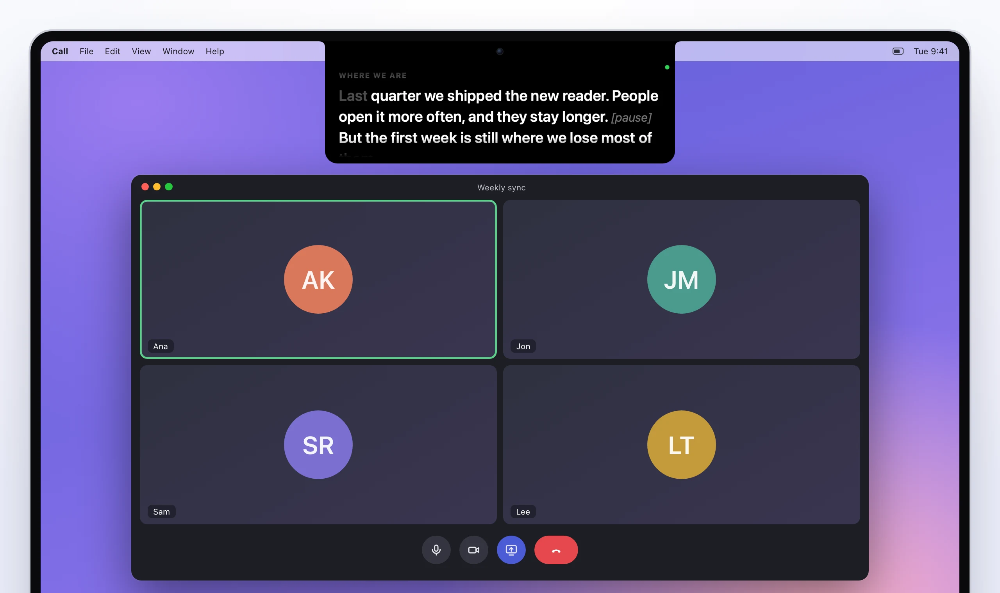
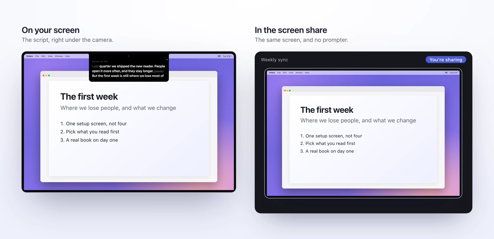
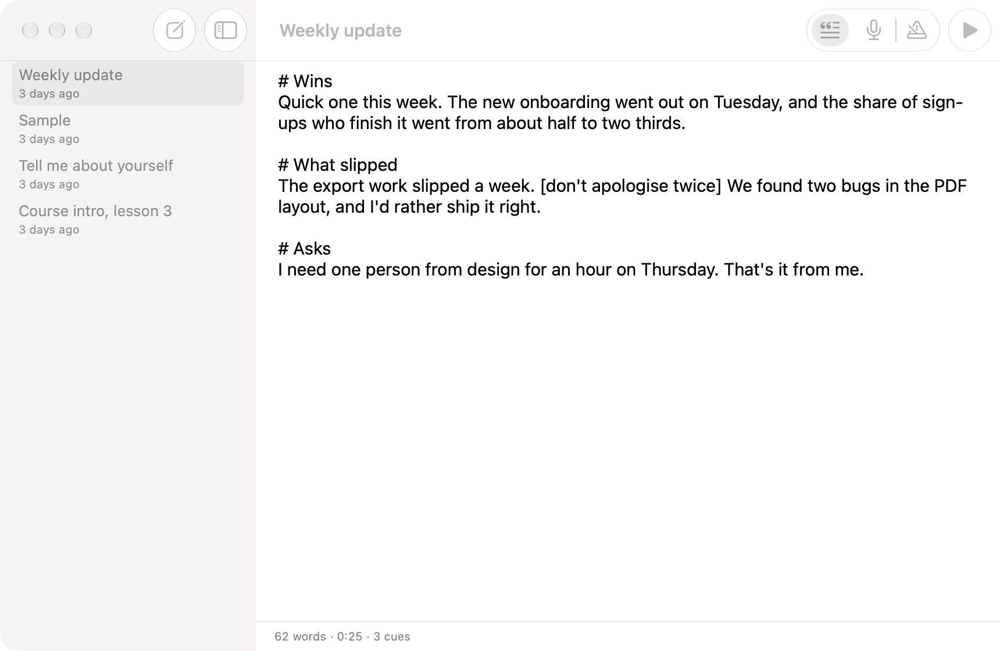

<p align="center">
  
</p>
<h1 align="center">Prompter</h1>
<p align="center"><b>A teleprompter under your Mac's camera that follows your voice and stays out of screen shares.</b><br>Read your script and still look people in the eye.</p>
<p align="center">
  
  
  
  
  
</p>
<p align="center">
  <a href="https://docs.tiresia.xyz/prompter/"><b>Docs</b></a> ·
  <a href="#features">Features</a> ·
  <a href="#pictures">Pictures</a> ·
  <a href="#install">Install</a> ·
  <a href="#build-and-test">Build and test</a> ·
  <a href="https://stuffs.tiresia.xyz/about-prompter/">About</a>
</p>

<picture>
  <source media="(prefers-color-scheme: dark)" srcset="docs/images/hero-dark.webp">
  
</picture>

## Why I made it

When you read from notes on a call, your eyes give you away. They drop to the notes, slide across and come back
up, and everyone can tell you're reading. On a laptop the camera is at the top of the screen, so that's where the
notes should be: right under the lens.

Prompter puts your script there, in a black strip that grows down out of the notch. It scrolls by listening for the
words of the script as you say them, so it keeps up when you speed up, waits when you stop to answer a question,
and catches up when you skip a paragraph. And the people on the call never see it: it's left out of screen
shares, recordings and screenshots.

It's free, it's a native Mac app, and your scripts are plain text files on your Mac. There's no account and nothing
in the cloud.

## Features

### Reading
- **Right under the camera.** The prompter hangs from the top of the screen, out of the notch on a MacBook and from
  the top centre on any other screen, so reading looks like looking at the person you're talking to.
- **Follow mode.** It hears the script's words as you say them and moves line by line, greying out what you've
  said. Going off script doesn't move it, and skipping ahead does.
- **Voice mode.** It scrolls at your speed while you talk and stops when you're quiet, for talking from notes.
- **Steady mode.** A classic fixed speed, with no microphone at all.
- **Hover to pause, click to play, scroll to move.** A small bar shows up on hover with the mode, the cues, the
  speed and close.

### Writing
- **Plain text scripts**, saved as you type, with a word count and how long it takes to say.
- **Cues.** A `# Heading` line marks a section you can jump to mid-talk, from the bar, the menu bar or ⌃⌥] and ⌃⌥[.
- **Notes to yourself.** `[pause]` or `[show the chart]` shows dim and is never read as script.
- **Edit while it's showing.** The prompter updates as you type and keeps your place.

### Staying out of sight
- **Hidden from screen shares, recordings and screenshots.** You see it, and your share shows what's behind it.
- **Speech recognition on your Mac** whenever the language allows it, and nothing written down.
- **Shortcuts from any app**, so you never have to find a window mid-call: ⌃⌥P to show and hide, ⌃⌥Space to
  pause, and a few more.

### Making it yours
- **Size, colour, spacing and alignment**, changing live while you rehearse.
- **Floating**, for a webcam that isn't at the top of the screen or a real teleprompter rig.
- **Mirror**, for reading off a teleprompter's glass.
- **Any screen**: the one with the notch, or whichever one your camera sits on.

## Pictures

<p align="center"></p>
<p align="center"><sub>Follow mode: what you've said goes grey, and the green dot means it hears you.</sub></p>

<picture>
  <source media="(prefers-color-scheme: dark)" srcset="docs/images/share-dark.webp">
  
</picture>
<p align="center"><sub>You see the script. The screen share doesn't.</sub></p>

<p align="center"></p>
<p align="center"><sub>Hover for the bar: mode, previous cue, play, next cue, slower, faster, close.</sub></p>

<picture>
  <source media="(prefers-color-scheme: dark)" srcset="docs/images/scripts-dark.webp">
  
</picture>
<p align="center"><sub>The scripts window: plain text, cues, notes, and how long it takes to say.</sub></p>

<table>
  <tr>
    <td></td>
    <td></td>
  </tr>
  <tr>
    <td align="center"><sub>Your size, colour and alignment.</sub></td>
    <td align="center"><sub>Mirrored, for teleprompter glass.</sub></td>
  </tr>
</table>

## Install

There's no download yet, and nothing to host: Prompter is a Mac app with no server behind it, so your own copy is
the one you build. It takes about a minute.

You need macOS 15 or later, the Xcode Command Line Tools (`xcode-select --install`) and
[XcodeGen](https://github.com/yonaskolb/XcodeGen) (`brew install xcodegen`). Xcode itself is only needed for the
icon.

```bash
git clone https://github.com/franz-rosenzweig/prompter.git
cd prompter
./build.sh
cp -R build/Prompter.app /Applications/
open /Applications/Prompter.app
```

Pick a script, press **Start** (⌘Return), and say yes when macOS asks for the microphone and speech recognition.
[Install](https://docs.tiresia.xyz/prompter/install/) in the docs covers signing, updating and removing it.

## Build and test

```bash
./build.sh          # build/Prompter.app, signed with your Apple Development certificate if you have one
./selftest.sh       # the parser, Follow's matcher, pictures of the prompter, and the screen-share check
xcodegen generate   # Prompter.xcodeproj, if you'd rather work in Xcode
```

The self-test runs a test copy under its own id, so it never touches your settings. It reads the sample script
aloud in simulation, with misheard and dropped words, and checks that Follow keeps up without ever running ahead,
that going off script doesn't move it, and that skipping a sentence catches up. Then it takes pictures of the
prompter and checks that a screenshot of its exact spot shows only what's behind it.
[Developing](https://docs.tiresia.xyz/prompter/DEVELOPING/) has the files, how Follow matches your words, and the
test switches.

## Docs

The full guide is at **[docs.tiresia.xyz/prompter](https://docs.tiresia.xyz/prompter/)**, and the same pages are in
[`docs/`](docs/README.md):

- [What is Prompter?](docs/what-is-prompter.md) · [Why I made it](docs/why-i-made-it.md) · [Install](docs/install.md)
- [Writing a script](docs/scripts.md) · [The prompter](docs/the-prompter.md) · [Follow, Voice and Steady](docs/modes.md)
- [Shortcuts and the menu bar](docs/shortcuts.md) · [Settings](docs/settings.md)
- [Hidden from screen shares](docs/screen-sharing.md) · [What it hears](docs/privacy.md) · [Troubleshooting](docs/troubleshooting.md)
- [Your own build](docs/own-copy.md) · [Developing](docs/DEVELOPING.md)

## License

MIT. Use it, change it, make it yours.
