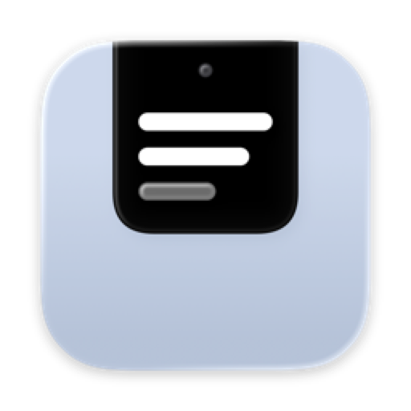

<h1 align="center">Prompter docs</h1>

How to write a script, read it right under the camera, and keep it out of the screen share.

These pages explain how Prompter works. It's a teleprompter for the Mac that hangs from the top of the screen,
right under the camera, so you can read your notes and still look people in the eye, and it scrolls by following
what you say. If you're new, read "What is Prompter?" first and then Install, which gets it onto your Mac in a couple
of minutes. The pages under "Using Prompter" go from writing a script to reading it on a call. The ones
at the bottom are for building your own copy and working on the code.

### Getting started
- [What is Prompter?](what-is-prompter.md) — what it does, the three places you'll find it, and what it needs
- [Why I made it](why-i-made-it.md) — the problem it solves, and what I left out on purpose
- [Install](install.md) — downloading it or building it, the first open, and the two permissions it asks for

### Using Prompter
- [Writing a script](scripts.md) — the scripts window, cues, notes to yourself, and where the files live
- [The prompter](the-prompter.md) — where it sits, the reading line, hovering, clicking, scrolling and the control bar
- [Follow, Voice and Steady](modes.md) — the three ways it scrolls, and which one to pick
- [Shortcuts and the menu bar](shortcuts.md) — everything you can do without hunting for a window
- [Settings](settings.md) — every setting, what it does, and its default

### Your privacy
- [Hidden from screen shares](screen-sharing.md) — what's left out of shares, recordings and screenshots, and where it still shows
- [What it hears](privacy.md) — the microphone, speech recognition, and what stays on your Mac

### When something's off
- [Troubleshooting](troubleshooting.md) — Follow not moving, the orange messages, and the permissions

### Running your own copy
- [Your own build](own-copy.md) — why there's nothing to host, signing it as yourself, and changing the defaults

### Under the hood
- [Developing](DEVELOPING.md) — the files, how Follow matches your words, the self-test and the pictures

### Something wrong, or missing?
If something doesn't work the way these pages say, or you'd like Prompter to do something it doesn't, open an issue
on the GitHub repo and say what you did and what happened. A screenshot helps, though the prompter won't be in it,
which is sort of the point.
