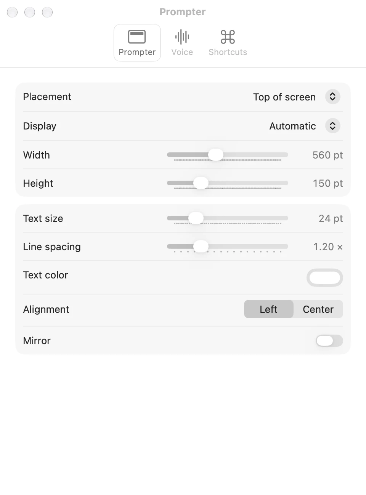
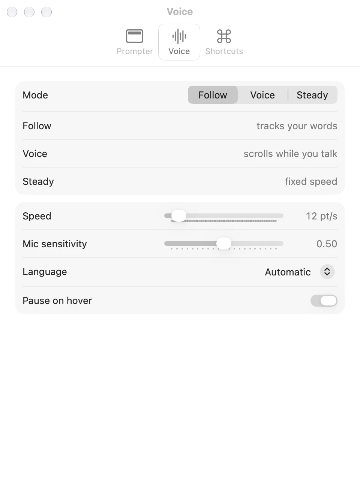

[Prompter docs](README.md) › Using Prompter

# Settings

Open them from the menu bar icon (**Settings…**) or with ⌘, in the scripts window. Everything changes the prompter
as you move it, even while it's showing, so you can set it up mid-rehearsal.

## Prompter

| Setting | What it does | Default |
|---|---|---|
| **Placement** | **Top of screen** hangs it from the top edge, under the camera. **Floating** makes it a card you can drag anywhere. | Top of screen |
| **Display** | Which screen it goes on. **Automatic** is the one with the notch, or the main one if none has a notch. | Automatic |
| **Width** | How wide it is, 280 to 1000 points. At the top of the screen it's never narrower than the notch plus a little. | 520 pt |
| **Height** | How tall the text part is, 60 to 420 points. | 150 pt |
| **Text size** | 14 to 64 points. | 24 pt |
| **Line spacing** | 1.0 to 1.8 times the line height. | 1.2× |
| **Text color** | Any colour. Cues and notes are drawn in a dimmer shade of it. | White |
| **Alignment** | **Left** or **Center**. | Left |
| **Mirror** | Flips it left to right, for reading off a teleprompter's glass. | Off |

## Voice

| Setting | What it does | Default |
|---|---|---|
| **Mode** | **Follow**, **Voice** or **Steady**. [Follow, Voice and Steady](modes.md) explains them. | Follow |
| **Speed** | How fast Voice and Steady scroll, 4 to 120 points a second. ⌃⌥= and ⌃⌥− change it from anywhere. | 12 pt/s |
| **Mic sensitivity** | How quiet still counts as talking, for Voice and for the dot. Higher hears softer speech. | 0.50 |
| **Language** | The language Follow listens for. **Automatic** is your Mac's. | Automatic |
| **Pause on hover** | Whether pointing at the prompter pauses it. | On |

## Shortcuts

The list of shortcuts, as in [Shortcuts and the menu bar](shortcuts.md).

## Where they're kept

In `~/Library/Preferences/xyz.tiresia.prompter.plist`. To start over with the defaults, quit Prompter and run
`defaults delete xyz.tiresia.prompter`.

Next: [Hidden from screen shares](screen-sharing.md) →
