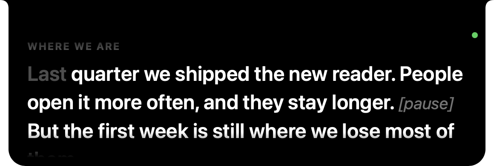
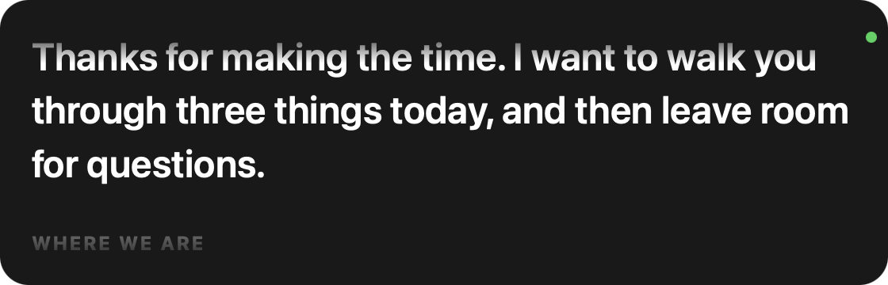
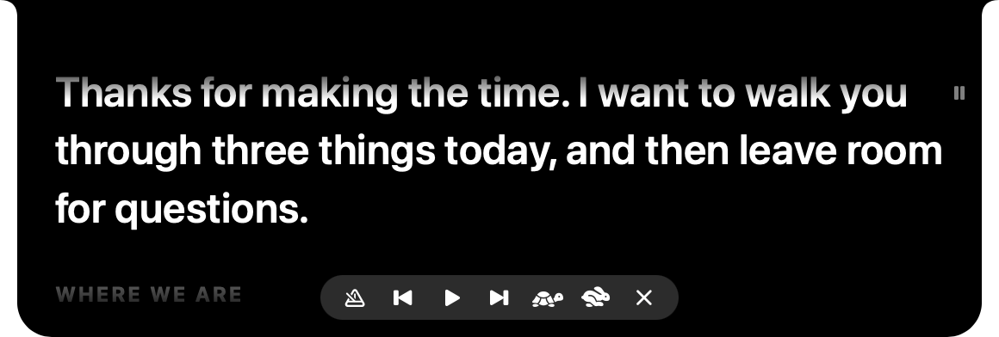
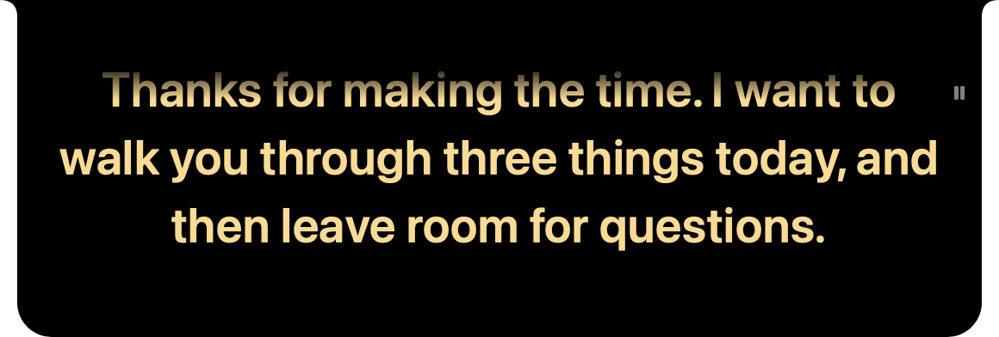
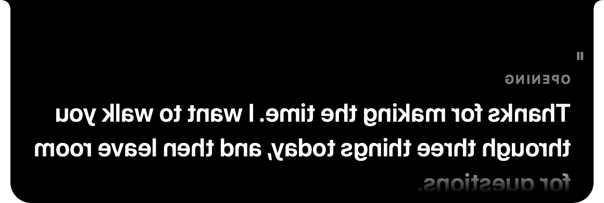

[Prompter docs](README.md) › Using Prompter

# The prompter

## Where it sits

At the top of the screen, centred and flush with the top edge. On a MacBook it grows out of the notch, so it looks
like part of the Mac. On a screen without a notch it hangs from the top the same way. It stays above other windows,
the menu bar and full-screen apps, on every Space, and it never takes the keyboard from the app you're in, so
clicking it doesn't pull you out of the call.

With more than one screen, it goes on the one with the notch, or the main one if none has a notch. Settings ›
Prompter › Display picks another. When the camera is somewhere else (an iMac's, or a webcam on a monitor), put the
prompter on that screen.

**Floating** (Settings › Prompter › Placement) turns it into a card you can drag anywhere, for a webcam that isn't
at the top of a screen, or a real teleprompter rig. It remembers where you left it. Width and Height set its size
either way.

## The reading line

The line you're on sits near the top of the strip, about a fifth of the way down, as close to the camera as it can
get. One line of what came before shows above it, fading out, and the next two or three lines show below. In Follow
mode, what you've already said turns grey, so one glance tells you where you are.

## Pausing, moving and the bar

- **Hover** over it and it pauses and shows the control bar. (Settings › Voice › Pause on hover turns the pausing
  off.)
- **Click** it to pause or play. A small pause sign shows at the top right while it's paused.
- **Scroll** with the trackpad or mouse to move through the script by hand. In Follow mode it picks up from wherever
  you leave it.

The bar, from the left:

| Button | Does |
|---|---|
| mode | switches to the next mode: Follow, then Voice, then Steady |
| previous | back to the start of this cue, and again to the one before (only shows when the script has cues) |
| play / pause | plays or pauses |
| next | jumps to the next cue (only shows when the script has cues) |
| tortoise, hare | slower and faster, in Voice and Steady |
| ✕ | hides the prompter |

## The dot

In Follow and Voice there's a small dot at the top right. It's green while it hears you talking, and dim while it's
listening and it's quiet. Steady has no dot, because it isn't listening. If something stops it from listening, an
orange line at the bottom says what, and [Troubleshooting](troubleshooting.md) explains each one.

## Making it yours

Text size, colour, line spacing, left or centred, and the width and height are all in [Settings](settings.md).
**Mirror** flips it left to right, for a beam-splitter teleprompter where you read it off the glass.

Next: [Follow, Voice and Steady](modes.md) →
